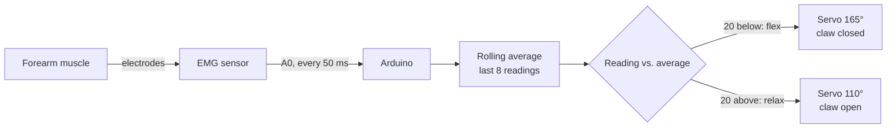

# EMG Robot Claw

Flex your forearm and a servo claw closes; relax and it opens. An EMG (muscle) sensor on the forearm feeds an Arduino, which drives the servo.

Demo video: https://drive.google.com/file/d/1HyN35DjB8WfcIFGGSs8RaMI56U4w3hBf/view

## How it works

- **Adaptive baseline.** The signal drifts with electrode contact, so each reading is compared with the average of the last 8 readings instead of a fixed value.
- **Hysteresis.** A flex needs a drop of 20 below the average and a relax needs a rise of 20 above it, so the claw doesn't chatter around one threshold.
- **Serial log** at 9600 baud prints the raw value, the average and the servo state for tuning.

## Hardware

- Arduino (Uno or similar)
- EMG muscle sensor with surface electrodes, signal on `A0`
- Servo driving a gripper claw, signal on pin `2`

## Tuning

| Constant | Default | Effect |
|---|---|---|
| `windowSize` | 8 | Readings in the rolling average (5 to 10 works) |
| `flexDrop` | 20 | How far below the average counts as a flex |
| `relaxRise` | 20 | How far above the average counts as a relax |
